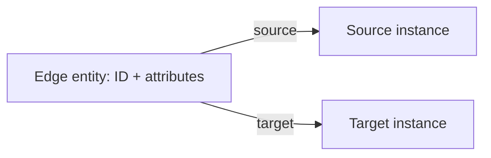
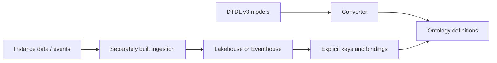

# Workarounds and boundaries

**Implemented** means this CLI emits the described definition.
**Guidance** means a separate data/runtime design, not an implemented migration
or a service-tested recipe. No policy implies data or query equivalence.

## Source validation

Fix malformed or unresolved input before mapping. Findings include DTMI, file,
JSON pointer, fidelity and a suggested action. Selecting an independent valid
root is allowed; excluded models remain visible in reports. Never repair a
vendor model silently. [Source coverage](dtdl-support.md).

## Inheritance

**Implemented:** `flatten-inheritance` copies effective properties from every
compatible parent; the manifest retains ancestry. Diamond inheritance
deduplicates the original declaration; conflicting declarations block.
Native single-parent output uses `--config examples\native.json` instead.
Both paths have [definition-level service evidence](fabric-acceptance.md).

Flattening loses native ancestry and polymorphic behavior. **Guidance:** retain
a type-ancestry table in a Lakehouse and join it explicitly when evaluating
subtype queries. Validate transitive membership and duplicate handling; do not
assume an Ontology query is equivalent to DTDL or ADT polymorphism.

## Components

DTDL Components are **by-value**, not independent twins.
**Implemented:** `component-properties` projects component state, and
`json-objects` publishes that struct as String. Contained relationships need
exact path-specific omissions; they must not become owner relationships.

**Guidance:** preserve component paths in Lakehouse columns or child rows
keyed by `(ownerInstanceId, componentPath)`. Do not invent independent twin IDs.
Typed native structs need actual recursive field backings; the converter does
not generate them. `UNBOUND_STRUCT` is a service-confirmed restriction for the
tested unbound shape, not a claim that backed structs are unsupported.

## Collections and enums

**Implemented:** `json-collections` and `json-objects` emit String definitions;
`enum-underlying` emits the enum's primitive. These do not serialize actual
values. Downstream ingestion must preserve valid JSON, enum values and source
schema constraints.

**Guidance:** use a Fabric Notebook or Dataflow to normalize collections into
Lakehouse child tables. Preserve `(ownerId, propertyPath, arrayIndex)` for arrays
or `(ownerId, propertyPath, mapKey)` for maps; distinguish missing, null and empty
values. Validate enums before loading. Native typed-array querying is not
recreated just because JSON is retained.

`GEOSPATIAL_MAPPING`: standard DTDL geometry has no converter-native mapping.
Keep the original coordinates and CRS assumptions in the data layer; evaluate
a spatial-capable engine separately. No Fabric spatial-parity test is claimed.

## Temporal primitives

**Implemented:** `temporal-strings` preserves date/time/duration as String.
`dateTime` has a direct definition mapping. **Guidance:** validate and transform
instance values in ingestion; keep original strings if lexical fidelity matters.
A time-of-day, duration, and timestamp are not interchangeable.

## Metadata and constraints

**Implemented:** `metadata-semantics` keeps units, writable intent, numeric
widths, labels and constraints in the manifest. It does not enforce them.
`FIELD_PRESENCE` remains blocking for Required fields.

**Guidance:** implement range/enum/presence validation and unit conversion in a
Notebook/Dataflow before writing curated tables. Keep rejected rows with reasons.
Resolve per-instance unit overrides before aggregation. Do not equate Fabric
inheritance metadata with DTDL instance-level `ValueAnnotation`/`Override`.

## Relationships

**Implemented:** concrete-target unbound definitions are service-verified.
They still contain no edge rows. Target mapping, `placeholder-targets`, and
`omit-relationships` require explicit choices; omissions use exact
`DTMI/relationship` or `DTMI/component/path/relationship` selectors.

`reify-relationship-properties` preserves edge attributes as properties on a
generated edge entity, with source and target links:

This is **not** native attributed-edge traversal. **Guidance:** load a Lakehouse
edge table keyed by source system and original edge ID, retaining endpoint IDs
and parallel edges. Bind its rows and both endpoints explicitly, then rewrite
queries for the extra hop. Definition acceptance does not verify those bindings.

## Runtime and bindings

The following are **guidance, not implemented or end-to-end tested here**:

| Need | Candidate Fabric items | What remains to build/test |
| --- | --- | --- |
| Current instance state | Lakehouse + Notebook/Dataflow | Stable keys, upserts/deletes, null/missing semantics, property bindings |
| Telemetry/history | Eventstream + Eventhouse/KQL database | Supported connector, timestamps, deduplication, ordering, retention, time-series bindings |
| Collection/edge remodeling | Lakehouse + Notebook | Original identities, reversible transformation, constraints, query rewrites |
| Scheduled backfill | Data Factory pipeline | Checkpoints, retries, source consistency and reconciliation |
| Analytics/alerts | Power BI, Real-Time Dashboard, Activator | Scenario-specific measures, refresh/freshness and alert semantics |

Commands, MQTT device transport and desired/reported state synchronization need
external integrations such as IoT Hub and application services. Ontology is not
a device-command runtime, ADT-compatible CRUD API, or automatic query translator.
`COMMAND_RUNTIME`, `MQTT_RUNTIME` and `HISTORIZATION_BINDING` remain blocking.

[Binding support][binding] does **not** imply [Graph eligibility][graph]:
current Graph guidance requires keys and bindings, supports Lakehouse/mirrored
Delta sources, excludes multiple backing tables, and requires refresh after
source-data changes. An unbound ontology cannot be queried as a populated graph.

## Capacity

`LIMIT_*` blocks publication; output is never truncated. Select smaller explicit
roots and review dependencies. Multiple REST requests cannot bypass per-item
limits. Whole-Willow conversion still exceeds the relationship limit even with
all policies enabled. [Limits and recovery](output-and-limits.md).

[binding]: https://learn.microsoft.com/fabric/iq/ontology/how-to-bind-data
[graph]: https://learn.microsoft.com/fabric/iq/ontology/how-to-use-ontology-graph
